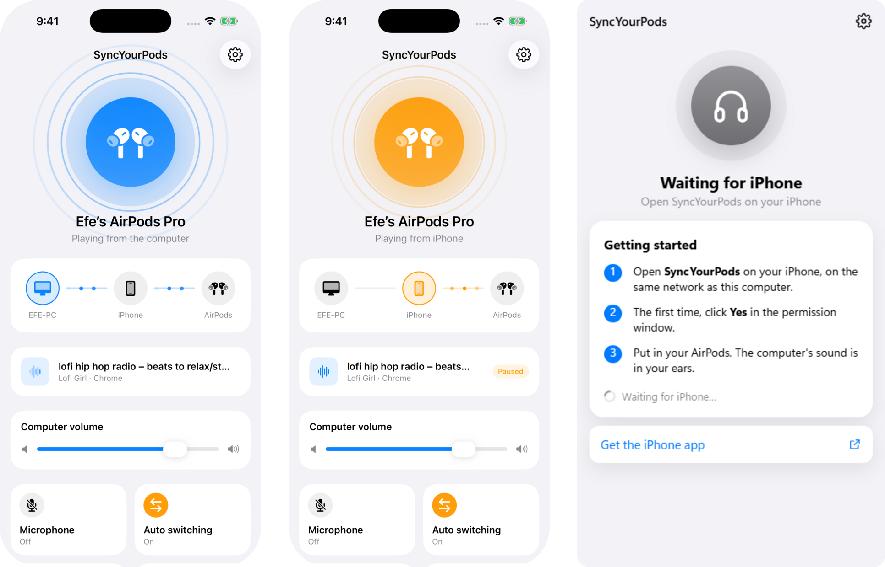

# SyncYourPods

**Your PC's sound on your AirPods, through your iPhone. And it switches back and forth by itself.**

AirPods hop between your iPhone, iPad and Mac without you touching anything. Pair them with a Windows PC over Bluetooth and that's gone: you dig into settings every time, the mic drops the audio to phone-call quality, and some desktops have no Bluetooth at all.

SyncYourPods leaves your AirPods connected to your iPhone the whole time. The PC streams its sound to the phone over your home Wi-Fi or Ethernet, and the phone plays it:

- **Watching something on the PC?** You hear the PC.
- **A video or a call starts on the phone?** The PC fades out (and can pause what it was playing). When the phone goes quiet, the PC comes back.
- **Music playing on the phone and you want the PC back?** Tap your AirPods once.

No Bluetooth on the PC, no drivers, no re-pairing.

The app is in English, or in Turkish on a Turkish iPhone / Windows.

<p align="center"></p>

## How it works

```
Windows PC ──── Wi-Fi / LAN ────▶ iPhone ──── Bluetooth ────▶ AirPods
WASAPI loopback                    mixes with other audio,
raw PCM over UDP, ~3 ms packets    steps aside when it starts
```

- **Discovery:** the PC announces itself over Bonjour (`_syncpods._tcp`, port 47800). The phone finds it without you typing an address, and the PC asks once before it accepts a new phone.
- **Audio:** uncompressed 48 kHz 16-bit PCM over UDP, 160 frames per packet, each packet also carrying the previous chunk as a spare for loss recovery. No codec, so no encoding delay and almost no CPU on the PC (~3 Mbit/s, nothing for a home network).
- **Clock drift:** the phone resamples by a tiny ratio based on how full its buffer is.
- **Switching:** the phone plays the PC audio in a session that *mixes with others*, and uses iOS's `secondaryAudioShouldBeSilencedHint` to notice when another app wants to play.
- **The PC goes quiet while connected:** it mutes its own speakers so the sound doesn't come out of both.
- **Microphone (optional):** the AirPods mic can reach the PC through [VB-CABLE](https://vb-audio.com/Cable/) (free). Bluetooth then drops to call quality, which is an Apple/Bluetooth limit, so it's off by default.

The ceiling on quality is the iPhone → AirPods Bluetooth link (AAC, ~256 kbps), and that part is Apple's.

## Get it

There is no App Store version. Outside the App Store, an iPhone app has to be signed for your own device, so for now you build it yourself:

### iPhone (needs a Mac with Xcode)

```bash
brew install xcodegen
cd ios
# in project.yml, set DEVELOPMENT_TEAM to your team and PRODUCT_BUNDLE_IDENTIFIER to your own ID
xcodegen
open SyncYourPods.xcodeproj    # pick your iPhone, Run
```

A free Apple ID works, but iOS then makes you re-install every 7 days. A paid developer account lasts a year.

### Windows

Grab `SyncYourPods.exe` from the [latest release](../../releases/latest), or build it:

```bash
cd pc
rustup target add x86_64-pc-windows-gnu
cargo build --release --target x86_64-pc-windows-gnu
```

It lives in the tray next to the clock and doesn't capture anything until a phone is connected. The exe isn't code-signed, so SmartScreen will ask: **More info → Run anyway**.

## Project layout

```
pc/            Windows app, Rust: WASAPI loopback, UDP sender, Bonjour, tray + small WebView2 panel
ios/Cekirdek   pure Swift core: packet format, jitter buffer, resampler, switching rules (runs on Linux: swift test)
ios/SyncYourPods   the SwiftUI app
araclar/       a fake phone in Python, for testing the PC side without an iPhone
```

Code identifiers are in Turkish, because that's how I think.

### Testing without the hardware

```bash
cd pc && cargo run &                 # PC side
python3 araclar/sahte_telefon.py     # pretends to be the phone
cd ios/Cekirdek && swift test        # core tests, also on Linux
```

## License

[MIT](LICENSE). Not affiliated with Apple. AirPods and iPhone are Apple's trademarks.
